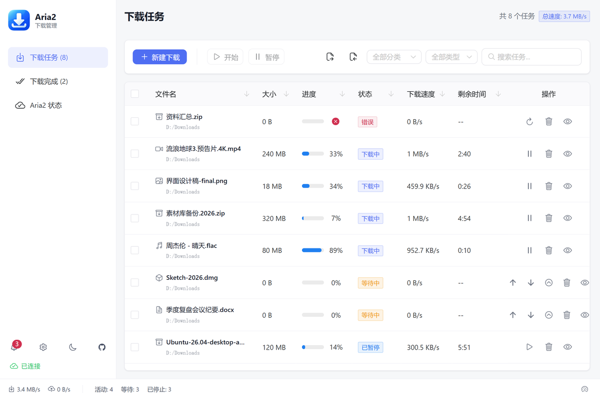
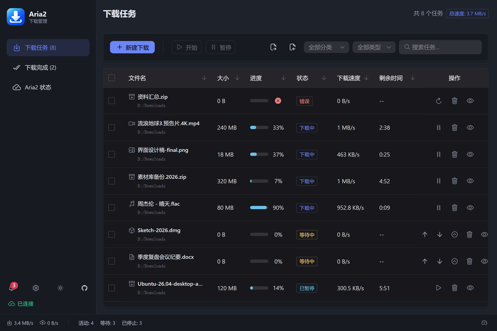
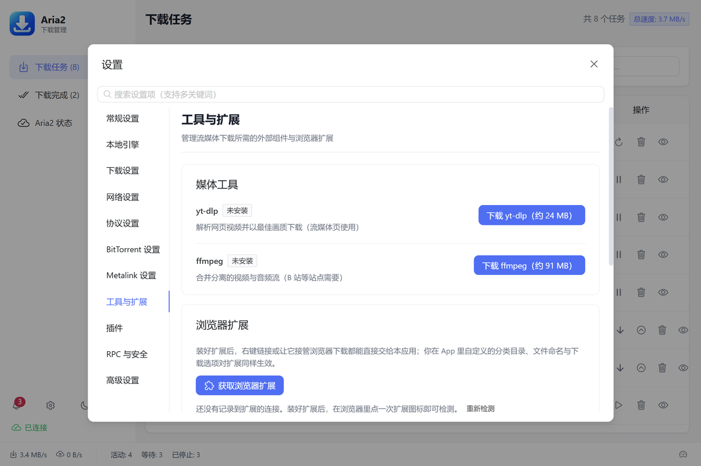

# Aria2 Desktop

**Aria2 with a desktop interface that makes sense**

[Download latest](https://github.com/Young-ZJ66/Aria2Desktop/releases/latest) · [Features](#features) · [Quick start](#quick-start) · [FAQ](#faq) · [Development](#development)

[简体中文](README.md) · **English**

## Overview

**Aria2 Desktop** is a desktop download manager built with Electron and Vue 3. It bundles the Aria2 engine and a graphical interface together: install it, open it, and start downloading — no command line and no separate engine setup.

- **Works out of the box**: Aria2 is bundled (1.37.0 on Windows and Linux, 1.36.0 on macOS), with no system-wide dependency
- **Broad protocol support**: HTTP/HTTPS, FTP/SFTP, BitTorrent, magnet links and Metalink
- **Browser integration**: the browser extension hands links to the app; categories, subdirectories and download options configured in the app apply to extension downloads too
- **Bandwidth-friendly updates**: Windows supports delta updates that reuse about 94% of the bytes between adjacent versions; macOS and Linux also support in-app update checks, downloads and installation

## Screenshots

| Dark theme | Tools and extensions |
|:---:|:---:|
|  |  |

## Features

### Downloads

- Multi-threaded downloads with resume support; global and per-task speed limits, switchable from the status bar
- **Download Queue 2.0**: a visible waiting queue with move-to-top, move-up, move-down and move-to-bottom actions, plus maximum concurrency and automatic retry policies
- **Task templates**: save proxy, User-Agent, Referer, Cookie, request headers and destination folder as a template, then reuse them when creating a task
- **Completion rules**: trigger move, rename, extract, open, notification and webhook actions based on category, extension or success/failure status; webhooks support HMAC-SHA256 signatures, exponential-backoff retries and a persisted failed-delivery queue that can be retried or cleared from Settings
- **Speed scheduler**: automatically switch between speed limits by weekday and time range (for example, limit bandwidth during weekday daytime)
- **Scheduled downloads**: automatically pause and resume all tasks during chosen time windows, ideal for overnight downloads; tasks you paused manually are left untouched
- **Automation page**: RSS/Atom subscriptions are fetched on a schedule, filtered by include/exclude patterns and added as downloads automatically (entry deduplication, per-fetch cap, optional save directory); watched folders auto-import new <code>.torrent</code> / <code>.metalink</code> / magnet-link text files, deleting or moving them into an <code>imported/</code> subfolder after import, with SHA-256 content deduplication
- Category-based folders for video, music, images, documents, archives and programs; filter the task list by category and source (HTTP/BT/magnet/streaming)
- BitTorrent: choose files and filter by type before downloading; stop and re-seed directly from the list; subscribe to trackers and aggregate the latest lists
- **BT Insights page**: a dedicated page with live peer details (client, IP geolocation, speeds, seeder flags) and tier-grouped trackers, plus summary cards for seeder count, aggregate speeds and info hash; refreshes every 5 seconds while visible
- Magnet links and <code>.torrent</code> / <code>.metalink</code> files registered as system handlers; save a magnet task as a <code>.torrent</code> file; duplicate magnet links are detected and reported
- Paste a browser "Copy as cURL" command to extract the URL, Referer, User-Agent and Cookie automatically; batch paste, drag-and-drop URLs or <code>.torrent</code>/<code>.metalink</code> files
- Failed tasks can be rebuilt and retried from their original source (URL, torrent or magnet info hash); unfinished tasks and download history support redacted export and validated import for easy migration
- Deleted task files go to the system recycle bin by default, so accidental deletions can be recovered; open completed files or their folders directly, or open several selected tasks at once
- **Speed graph and retry markers**: the Status page shows live speed history and marks automatic retries on the graph; task details include peer clients and IP geolocation

### Interface and system integration

- Dark/light theme (including follow-system), 21 interface languages (Simplified Chinese / Traditional Chinese / English / Japanese / Korean / German / French / Spanish / Portuguese / Italian / Russian / Arabic / Hindi / Thai / Vietnamese / Indonesian / Turkish / Dutch / Polish / Ukrainian / Czech); built-in **Diagnostics Center** checks RPC, disk space, secrets, UPnP, trackers and history storage, then exports a redacted report
- Task details with peers, servers and piece information; live speed graph and connection count
- Notification center with completed/failed records and unread badges
- Tray icon, taskbar progress and launch-at-login; after download completion, apply completion rules to open files/folders, shut down, sleep or close the app
- Copy a download link and return to the app to be prompted with a new-task window (clipboard monitoring can be disabled in Settings); global shortcuts (<code>Ctrl+N</code> new task, <code>Ctrl+F</code> search, <code>Ctrl+Shift+P</code> pause all, and more)
- One-click system proxy detection and autofill; in-app update checks (delta updates on Windows, full packages on macOS/Linux); Linux AppImages embed update information and ship `.zsync` files for delta upgrades via AppImageUpdate / <code>appimageupdatetool</code>

### Extensions and streaming

- Install directly from the Edge Add-ons store; Chrome can be side-loaded (see [extension/README.md](extension/README.md)); releases also carry a Firefox (AMO) variant zip
- Send a link from the context menu, send the current page from the popup, or batch-scrape links from a page; optionally take over browser downloads
- Streaming: yt-dlp integration supports 1000+ sites, downloaded on demand with SHA-256 verification; playlist entry picking, subtitles (including auto-generated, converted to <code>srt</code>), cookie files and quality presets (best/1080p/720p/480p/MP3 extract) are supported, with playlist progress showing the current entry title and index; ffmpeg merges separate audio/video streams for sites such as Bilibili
- Plugin system: plugins run in a separate <code>utilityProcess</code> with declared permissions, a whitelisted IPC bridge, crash isolation and automatic restart; plugin entry execution has a 3-second timeout
- Plugin marketplace: configurable registry URL, SHA-256 integrity checks and Ed25519/RSA publisher signature verification, with install, update and report actions; see [docs/plugin-development.md](docs/plugin-development.md)
- Built-in Auto Retry sample plugin: retries failed downloads up to three times (the native UI only offers manual retry), demonstrating event hooks and the <code>aria2:write</code> permission

### Advanced

- **UPnP port mapping**: automatically request BT/DHT port mappings from your router so other peers can connect to you (better seeding)
- **AI assistant access (MCP)**: MCP-capable clients (Claude Desktop, Cursor, etc.) can manage tasks, queues, global settings and diagnostics through the local interface, with 22 tools, 4 resources and 2 prompt templates
- **Web console**: when enabled in Settings, access tasks, queues, statistics and audit logs from a browser or phone; installable PWA with scoped API tokens (read/write/control/audit/admin), an OpenAPI 3.0.3 document at <code>/openapi.json</code>, IP/CIDR allowlists and operation auditing
- **Settings backup**: export all settings to JSON (secrets optional and behind a confirmation), and import with a dry-run preview of applied/skipped/rejected keys while local secrets are preserved
- **Multi-instance management**: save multiple RPC connection profiles, batch-test latency and versions, and switch the active instance with one click
- **SQLite history**: download history is stored in SQLite, removing the old 10 MB JSON limit, with automatic migration of legacy data
- **Delta updates (Windows)**: download only changed blocks, then verify the final file against its <code>.sha256</code>
- **Headless mode and automation**: <code>Aria2Desktop --headless</code> hides the main window and keeps only the download engine, browser extension API and MCP server running, ideal for remote management or an always-on download machine; see [docs/automation-cli-webhook.md](docs/automation-cli-webhook.md) for CLI and webhook usage, and [docs/headless.md](docs/headless.md) for systemd / Windows scheduled-task setups

## System requirements

| | Requirement |
|---|---|
| Windows | Windows 10/11, x64 or x86 |
| macOS | Intel or Apple Silicon (system version supported by Electron 43) |
| Linux | x64 or arm64, AppImage or deb |
| Disk | About 100 MB for the installer and about 300 MB installed (plus space for downloads) |

## Quick start

### 1. Install

Download the package for your platform from [Releases](../../releases): <code>Setup.exe</code> (or the portable <code>portable.zip</code>) on Windows,
<code>dmg</code> on macOS, <code>AppImage</code> or <code>deb</code> on Linux.

> Windows installers are currently unsigned, so SmartScreen may show "Unknown publisher"; public macOS builds are unsigned and not notarized, so right-click → Open on first launch.
> Every asset has a matching <code>.sha256</code> file for verification.

### 2. Add your first download

Click "New Download" and paste a URL, or drag a URL / torrent file into the window. Copying a link and returning to the app also opens the new-task window automatically.

### 3. Engine and port

The bundled engine starts with the app and listens on RPC port <code>6800</code> by default, on localhost only. If the port is in use,
change it under "Settings → RPC & Security"; the "Test connection" button on the same page confirms engine status.

### 4. Browser extension (optional but recommended)

**Edge users**: install from the [Edge Add-ons store](https://microsoftedge.microsoft.com/addons/detail/aria2-desktop/fmjmpbnokancjlangmmepdpdebafkngp), which updates automatically.
The app's "Settings → RPC & Security → Browser extension" section also has a shortcut.

**Chrome users** or manual installation: see [extension/README.md](extension/README.md) for side-loading and allowlist steps.

> The extension and app communicate over a local loopback API (<code>http://localhost:6801</code>, authenticated with the RPC secret); it listens on localhost only and is not exposed to the network.
> When the app is not running, the extension falls back to the built-in Aria2 RPC connection (default <code>http://localhost:6800</code>) with reduced functionality.

### 5. Streaming (optional)

Open New Download → "Streaming" and follow the prompt to download yt-dlp on first use (about 20–40 MB, downloaded from the official release and verified with SHA-256).
When audio/video merging is needed, you will be prompted to download ffmpeg (on macOS, <code>brew install ffmpeg</code> also works).
An existing yt-dlp / ffmpeg on your PATH is used directly.

## FAQ

**The installer says "Unable to close Aria2Desktop"**
The app may be running in the tray. The installer asks it to exit gracefully first (up to 12 seconds, to save the session), then terminates it if needed.
If it still fails, exit from the tray menu and try again.

**Windows shows an unknown publisher / SmartScreen warning**
Windows installers are currently unsigned. Click "More info → Run anyway"; verify the <code>.sha256</code> on the Release page when needed.

**The extension cannot connect to the app**
Make sure the app is running and the secret in the extension matches "Settings → RPC & Security".
If a system proxy is enabled, <code>127.0.0.1</code> may be intercepted — change the host to <code>localhost</code> and retry.

**Port 6800 is already in use**
Another Aria2 Desktop instance or another download tool is probably using it. Quit the extra instance or change the port in Settings.

**Automatic update fails / verification fails**
The app compares the downloaded file with the Release <code>.sha256</code>; on mismatch it refuses to install and falls back to a full download. You can also download and install the package manually.

**Files remain after uninstalling**
Settings remain in <code>%APPDATA%/aria2-desktop</code> (configuration and session data). Delete that directory manually for a complete cleanup.

## Privacy

The app collects no telemetry or personal data. See the [privacy policy](docs/privacy.md).

## Technology stack

| | |
|---|---|
| Desktop framework | Electron 43 |
| UI | Vue 3 + Naive UI 2 + Pinia 3 |
| Language / build | TypeScript 6, Vite 8 |
| Charts | ECharts 6 |
| Internationalization | vue-i18n 11 (21 languages, including Simplified/Traditional Chinese, English, Japanese, Korean, German, French, Spanish, Russian, Arabic and more) |
| Download engine | Aria2 1.37.0 (Windows, Linux) / 1.36.0 (macOS) |
| Testing | Vitest 5, CDP-driven end-to-end tests against the real app |

## Development

~~~bash
npm install
npm run dev               # development (Vue + Electron)
npm run build             # production build
npm run test:run          # unit tests
npm run typecheck         # type checking (main process + test code + renderer)
npm run test:e2e          # end-to-end (launches the real app and exercises download/extract/settings)
npm run dist:win64        # package Windows x64 installer + portable zip
npm run dist:linux:arm64  # package Linux arm64
~~~

Project structure and development conventions (logging, type checking, dependency grouping, platform differences, release process) are documented in [CONTRIBUTING.md](CONTRIBUTING.md).

## Roadmap

See [docs/roadmap.md](docs/roadmap.md) for the v1.3.x direction, scope and acceptance criteria.

## Contributing

Issues and pull requests are welcome. Before submitting, run <code>npm run typecheck && npm run test:run</code>;
use Conventional Commits (<code>feat:</code> / <code>fix:</code> / <code>docs:</code> …).

- Issue tracker: [GitHub Issues](../../issues)
- Email: 1600386893@qq.com

## License

This project is released under the [MIT License](LICENSE).
See [resources/aria2/README.md](resources/aria2/README.md) for how the bundled Aria2 engine is compiled and its GPLv2 compliance notes.

## Acknowledgements

[Aria2](https://github.com/aria2/aria2) · [AriaNg](https://github.com/mayswind/AriaNg) · [yt-dlp](https://github.com/yt-dlp/yt-dlp) ·
[Motrix](https://github.com/agalwood/Motrix) · [Electron](https://www.electronjs.org/) · [Vue.js](https://vuejs.org/) ·
[Naive UI](https://www.naiveui.com/) · [ECharts](https://echarts.apache.org/) · [Vite](https://vite.dev/)

## Star history

<a href="https://star-history.com/#Young-ZJ66/Aria2Desktop&Date">
  <picture>
    <source media="(prefers-color-scheme: dark)" srcset="https://api.star-history.com/svg?repos=Young-ZJ66/Aria2Desktop&type=Date&theme=dark" />
    
  </picture>
</a>

---

**If this project helps you, please give it a Star ⭐**

