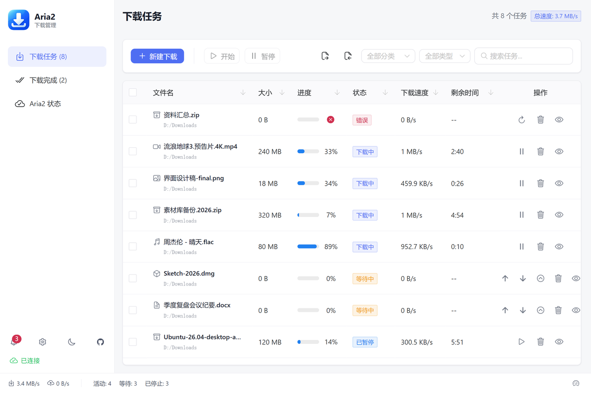
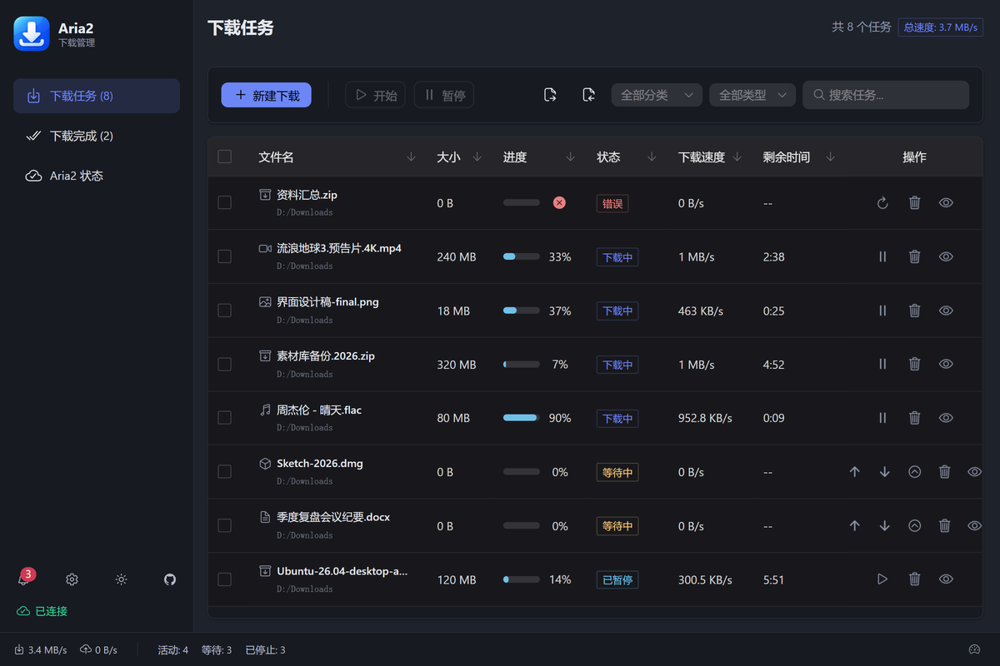
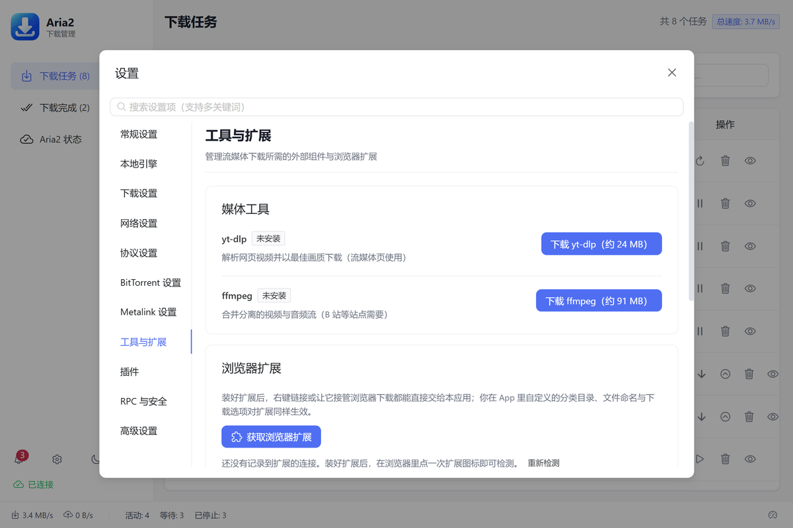

# Aria2 Desktop

<div align="center">

[](https://github.com/Young-ZJ66/Aria2Desktop/releases/latest)
[](https://github.com/Young-ZJ66/Aria2Desktop/releases)
[](#系统要求)
[](LICENSE)

**把 Aria2 装进一个看得懂的桌面界面**

[下载最新版](https://github.com/Young-ZJ66/Aria2Desktop/releases/latest) · [功能](#功能) · [快速开始](#快速开始) · [常见问题](#常见问题) · [开发](#开发)

</div>

## 简介

**Aria2 Desktop** 是一款基于 Electron + Vue 3 的桌面下载管理器，把 Aria2 引擎和图形界面打包在一起：
装完打开就能用，不需要命令行，也不需要单独配置引擎。

- **开箱即用**：安装包内置 Aria2（Windows 1.37.0 / macOS、Linux 1.36.0），不依赖系统环境
- **协议齐全**：HTTP/HTTPS、FTP/SFTP、BitTorrent、磁力链接、Metalink
- **扩展协同**：浏览器扩展把链接交给 App 处理，你在 App 里设的分类、子目录与下载选项对扩展同样生效
- **省流更新**：Windows 支持差量更新，实测相邻版本可复用约 94% 的字节

## 界面



| 深色主题 | 工具与扩展 |
|:---:|:---:|
|  |  |

## 功能

### 下载

- 多线程、断点续传；全局与单任务限速，底部状态栏一键切换
- **速度调度**：按星期/时间段自动切换到不同限速（例如工作日白天限速）
- **定时下载**：按时间段自动暂停/恢复全部任务，适合夜间挂机；不会覆盖你手动暂停的任务
- 分类下载：按视频/音乐/图片/文档/压缩包/程序自动归入子目录，列表可按分类与来源（HTTP/BT/磁力/流媒体）筛选
- BT：下载前勾选文件并按类型快筛，列表内直接停止/重新做种，Tracker 订阅自动聚合最新列表
- 磁力链接注册为系统处理器；同一磁力重复添加会被识别并提示
- 粘贴浏览器「Copy as cURL」自动提取链接、Referer、User-Agent 与 Cookie；支持批量粘贴、拖拽 URL 或 `.torrent`/`.metalink`
- 失败任务可「重试并编辑参数」；未完成任务与完成历史支持导出/导入，换机迁移方便
- 删除任务文件默认移到系统回收站，误删可恢复

### 界面与系统集成

- 深色/浅色主题（可跟随系统）、中英文界面
- 任务详情含 Peer、服务器、分片信息；实时速度曲线与连接数
- 通知中心保留完成/失败记录与未读角标
- 托盘常驻、任务栏进度、开机自启；下载全部完成后可关机/休眠/关闭应用
- 复制下载链接后切回应用自动弹出新建窗口；全局快捷键（`Ctrl+N` 新建、`Ctrl+F` 搜索、`Ctrl+Shift+P` 暂停全部…）
- 系统代理一键检测填入；应用内检查更新

### 扩展与流媒体

- Edge 加载项商店可直接安装；Chrome 可旁加载（步骤见 [extension/README.md](extension/README.md)）
- 右键链接发送到 App、弹窗发送当前页、从页面批量抓取链接；可选接管浏览器下载
- 流媒体：集成 yt-dlp 支持 1000+ 站点，按需下载并校验 SHA-256；B 站等音视频分离的站点由 ffmpeg 合并
- 插件系统：插件目录 `%APPDATA%/aria2-desktop/plugins/`，带权限声明与生命周期（插件在主进程运行，属完全可信代码）

### 进阶

- **UPnP 端口映射**：自动向路由器申请 BT/DHT 端口映射，让其他 Peer 能主动连上你（做种更有优势）
- **AI 助手接入（MCP）**：支持 MCP 的客户端（Claude Desktop、Cursor 等）可通过本机接口添加下载、查询进度、暂停/恢复
- **差量更新（Windows）**：只下载变化的分块，最终仍强制比对 `.sha256`

## 系统要求

| | 要求 |
|---|---|
| Windows | Windows 10/11，x64 或 x86 |
| macOS | Intel 或 Apple Silicon（系统版本需被 Electron 43 支持） |
| Linux | x64，AppImage 或 deb |
| 磁盘 | 安装包约 100 MB，安装后约 300 MB（另需下载目录空间） |

## 快速开始

### 1. 安装

到 [Releases](../../releases) 下载对应平台的包：Windows 用 `Setup.exe`（或免安装的 `portable.zip`），
macOS 用 `dmg`，Linux 用 `AppImage` 或 `deb`。

> 安装包未做代码签名：Windows 可能提示「未知发布者」，macOS 首次打开需右键 →「打开」。
> 每个资产都附带同名 `.sha256`，可自行校验。

### 2. 添加第一个下载

点「新建下载」粘贴链接，或把链接 / 种子文件直接拖进窗口。复制链接后切回应用也会自动弹出新建窗口。

### 3. 引擎与端口

内置引擎随应用启动，默认 RPC 端口 `6801`，只监听本机。端口被别的程序占用时，
到「设置 → RPC 与安全」换一个端口；同页的「测试连接」可确认引擎状态。

### 4. 浏览器扩展（可选但推荐）

**Edge 用户**：直接从 [Edge 加载项商店](https://microsoftedge.microsoft.com/addons/detail/aria2-desktop/fmjmpbnokancjlangmmepdpdebafkngp) 安装，
随浏览器自动更新。App 内「设置 → RPC 与安全 → 浏览器扩展」也有直达按钮。

**Chrome 用户**或需要手动安装时：见 [extension/README.md](extension/README.md)（含旁加载与白名单步骤）。

> 扩展与 App 通过本机回环接口通信（`http://localhost:6801`，需 RPC 密钥鉴权），只监听本机、不对外开放。
> App 未运行时扩展回落到内置规则直连引擎，功能不受影响。

### 5. 流媒体（可选）

新建下载 →「流媒体」标签，首次按提示下载 yt-dlp（约 20–40 MB，从官方 Release 下载并校验 SHA-256）。
涉及音视频合并时会提示下载 ffmpeg（macOS 也可 `brew install ffmpeg`）。
已自行安装并加入 PATH 的 yt-dlp / ffmpeg 会被直接使用。

## 常见问题

**安装时提示「无法关闭 Aria2Desktop」**
应用可能驻留在托盘。安装程序会先请求它正常退出（最多等 12 秒，以便保存会话）再结束进程；
若仍失败，从托盘菜单退出后重试。

**Windows 提示未知发布者 / SmartScreen 拦截**
安装包没有签名。点「更多信息 → 仍要运行」；需要校验时比对 Release 页的 `.sha256`。

**扩展连不上 App**
先确认 App 在运行、扩展里填的密钥与「设置 → RPC 与安全」一致。
如果电脑开着系统代理，`127.0.0.1` 可能被代理拦截 —— 把主机改成 `localhost` 再试。

**提示端口 6801 被占用**
多半是另一个 Aria2 Desktop 实例或别的下载工具占着。退出多余实例，或在设置里换端口。

**自动更新失败 / 校验不通过**
应用会比对 Release 的 `.sha256`，不匹配就拒绝安装并回落完整下载；网络异常时可手动下载安装包覆盖安装。

**卸载后有残留**
设置文件留在 `%APPDATA%/aria2-desktop`（含配置与会话），需要彻底清理时手动删除该目录。

## 技术栈

| | |
|---|---|
| 桌面框架 | Electron 43 |
| 界面 | Vue 3 + Naive UI 2 + Pinia 3 |
| 语言 / 构建 | TypeScript 6、Vite 8 |
| 图表 | ECharts 6 |
| 国际化 | vue-i18n 11（中文 / English） |
| 下载引擎 | Aria2 1.37.0（Windows）/ 1.36.0（macOS、Linux） |
| 测试 | Vitest 5、CDP 驱动的真实应用端到端 |

## 开发

[](https://github.com/Young-ZJ66/Aria2Desktop/actions/workflows/ci.yml)

```bash
npm install
npm run dev          # 开发环境（Vue + Electron）
npm run build        # 构建生产版本
npm run test:run     # 单元测试
npm run typecheck    # 类型检查（主进程 + 测试代码 + 渲染层）
npm run test:e2e     # 端到端（真启动应用跑一遍下载/解压/设置）
npm run dist:win64   # 打包 Windows x64 安装包 + 便携版
```

项目结构、开发约定（日志、类型检查、依赖归类、平台差异、发版流程）见 [CONTRIBUTING.md](CONTRIBUTING.md)。

## 贡献

欢迎 Issue 与 PR。提交前请跑 `npm run typecheck && npm run test:run`；
提交信息使用 Conventional Commits（`feat:` / `fix:` / `docs:` …）。

- 问题反馈：[GitHub Issues](../../issues)
- 邮件：1600386893@qq.com

## 许可证

本项目采用 [MIT License](LICENSE)。
内置 Aria2 引擎的编译方式与 GPLv2 合规说明见 [resources/aria2/README.md](resources/aria2/README.md)。

## 致谢

[Aria2](https://github.com/aria2/aria2) · [AriaNg](https://github.com/mayswind/AriaNg) · [yt-dlp](https://github.com/yt-dlp/yt-dlp) ·
[Motrix](https://github.com/agalwood/Motrix) · [Electron](https://www.electronjs.org/) · [Vue.js](https://vuejs.org/) ·
[Naive UI](https://www.naiveui.com/) · [ECharts](https://echarts.apache.org/) · [Vite](https://vite.dev/)

## Star 趋势

<a href="https://star-history.com/#Young-ZJ66/Aria2Desktop&Date">
  <picture>
    <source media="(prefers-color-scheme: dark)" srcset="https://api.star-history.com/svg?repos=Young-ZJ66/Aria2Desktop&type=Date&theme=dark" />
    
  </picture>
</a>

---

<div align="center">

**如果这个项目对你有帮助，请给个 Star ⭐**

</div>
